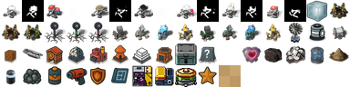

# @metta-ai/mettagrid-client

TypeScript client library for real-time [mettagrid](https://github.com/Metta-AI/metta) game streaming. Connect to a running simulation over WebSocket, render the game in a lightweight Canvas viewer, and build custom UIs with React hooks.



## Features

- **WebSocket client** with auto-reconnect, subscriptions, history requests, and ping keepalive
- **Delta-protocol state engine** — merges incremental updates across 1500+ objects per step
- **Sprite-based Canvas 2D renderer** using downscaled MettaScope game art (57KB atlas)
- **React hook** (`useMettagrid`) with `useSyncExternalStore` for tear-free rendering
- **Playback controls** — pause, seek backwards/forwards, speed (½x to 10x)
- **Pan / zoom / pinch** — mouse wheel zoom, drag to pan, two-finger pinch on mobile
- **AoE territory overlays** — colored ground tint around team-owned junctions
- **Agent tags and info** — team-colored labels, click-to-select detail panel
- **Zero runtime dependencies** — React 18+ as optional peer dep for hooks/components
- **Dual ESM/CJS** output with full TypeScript declarations

## Install

```bash
bun add @metta-ai/mettagrid-client
# or
npm install @metta-ai/mettagrid-client
```

## Quick Start

### React (recommended)

```tsx
import { useMettagrid, GridCanvas, AgentInfo, PlaybackBar } from '@metta-ai/mettagrid-client/react'

function GameViewer() {
  const {
    connectionState, metadata, displayStep, objects, agents,
    isPaused, pause, resume, seekTo, maxBufferedStep,
    speed, setSpeed,
  } = useMettagrid('ws://localhost:8766')

  const [selectedId, setSelectedId] = useState(null)

  return (
    <div>
      <GridCanvas
        objects={objects}
        metadata={metadata}
        selectedId={selectedId}
        onSelectObject={setSelectedId}
        cellSize={10}
      />
      <PlaybackBar
        currentStep={currentStep}
        displayStep={displayStep}
        maxStep={maxBufferedStep}
        isPaused={isPaused}
        onPause={pause}
        onResume={resume}
        onSeek={seekTo}
        speed={speed}
        onSpeedChange={setSpeed}
        connectionState={connectionState}
      />
      {selectedId && (
        <AgentInfo
          object={objects.get(selectedId)}
          metadata={metadata}
        />
      )}
    </div>
  )
}
```

### Headless (no React)

```ts
import { MettagridClient } from '@metta-ai/mettagrid-client'

const client = new MettagridClient('ws://localhost:8766')

client.on('metadata', (meta) => {
  console.log(`Map: ${meta.map_size[0]}x${meta.map_size[1]}, ${meta.num_agents} agents`)
})

client.on('step', (step) => {
  console.log(`Step ${step.step}: ${step.objects.length} objects updated`)
})

client.on('episode-end', (infos) => {
  console.log('Episode finished', infos)
})

client.connect()
```

## Architecture

```
┌─────────────────────────────────┐
│  Python mettagrid engine        │
│  WebSocketReplayStreamer        │
│  (ws://host:port)               │
└──────────┬──────────────────────┘
           │ JSON over WebSocket
           ▼
┌─────────────────────────────────┐
│  MettagridClient                │  ← framework-agnostic core
│  ├── WebSocket connection       │
│  ├── ObjectStateMap (delta)     │
│  └── StepBuffer (history)       │
└──────────┬──────────────────────┘
           │
           ▼
┌─────────────────────────────────┐
│  useMettagrid hook              │  ← React layer
│  ├── useSyncExternalStore       │
│  ├── Playback (pause/seek)      │
│  └── Speed throttling           │
└──────────┬──────────────────────┘
           │
           ▼
┌─────────────────────────────────┐
│  GridCanvas                     │  ← Canvas 2D renderer
│  ├── Sprite atlas (57KB)        │
│  ├── Background cache (walls)   │
│  ├── AoE territory overlay      │
│  ├── Team-tinted agents         │
│  └── Pan / zoom / pinch         │
└─────────────────────────────────┘
```

## Exports

### `@metta-ai/mettagrid-client` (core)

| Export | Description |
|--------|-------------|
| `MettagridClient` | WebSocket client class with auto-reconnect |
| `ObjectStateMap` | Delta-protocol state manager |
| `StepBuffer` | Bounded step history for seek/scrub |
| `DEFAULT_OPTIONS` | Default client options |
| Types: `GridObject`, `EpisodeMetadata`, `StepData`, `ConnectionState`, etc. | Full protocol types |

### `@metta-ai/mettagrid-client/react` (React)

| Export | Description |
|--------|-------------|
| `useMettagrid(url, options?)` | Hook returning connection state, objects, playback controls |
| `GridCanvas` | Sprite-based Canvas 2D renderer with pan/zoom |
| `AgentInfo` | Selected agent detail panel |
| `PlaybackBar` | Step slider, play/pause, speed buttons |

## Protocol

The client implements the [WebSocket Replay Streaming Protocol](https://github.com/Metta-AI/metta/blob/main/packages/mettagrid/docs/websocket_protocol.md) (v1).

### Connection flow

1. Client connects to `ws://host:port`
2. Server sends `server_info` with protocol version
3. Client sends `subscribe` with optional `from_step`
4. Server streams `metadata` → buffered `step` messages → live `step` messages
5. Client can request `history` ranges or `get_metadata` at any time

### Delta protocol

Step 0 sends all objects with full fields. Subsequent steps send only changed fields per object. Objects not mentioned retain their previous state. The `ObjectStateMap` handles this automatically.

## Running a Game Server

Start a mettagrid simulation with WebSocket streaming enabled:

```bash
# Simple demo (random agents, small map)
cd metta
uv run python packages/mettagrid/python/src/mettagrid/streaming/test_local.py \
  --port 8766 --steps 2000 --agents 8

# Full CvC game
uv run python packages/mettagrid/python/src/mettagrid/streaming/test_cvc.py \
  --port 8766 --max-steps 5000
```

Or attach the streamer programmatically:

```python
from mettagrid.streaming import WebSocketReplayStreamer

streamer = WebSocketReplayStreamer(host="0.0.0.0", port=8766)
simulator.add_event_handler(streamer)
```

## Sprite Atlas

The renderer includes a 57KB sprite atlas with 59 sprites downscaled from [MettaScope](https://github.com/Metta-AI/metta/tree/main/packages/mettagrid/nim/mettascope) game art:

- **Agents**: robot sprites with team-color tinting masks (6 types × 1 direction)
- **Objects**: hub, junction, extractor, charger, generator, chest, block, ship, armory, lab
- **Resources**: heart, carbon, germanium, oxygen, silicon, energy, ore, battery
- **Effects**: frozen overlay

Regenerate the atlas from MettaScope source PNGs:

```bash
bun scripts/build-atlas.ts /path/to/metta/packages/mettagrid/nim/mettascope/data
```

## Development

```bash
bun install
bun run build        # Build ESM + CJS + types
bun run dev          # Watch mode
bun run typecheck    # Type check without emit
```

## License

MIT
